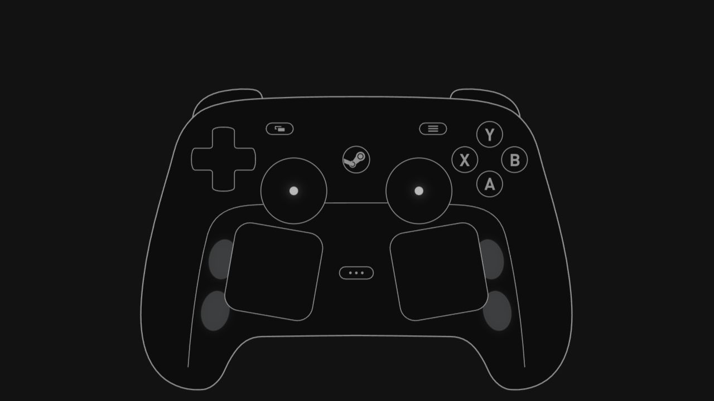
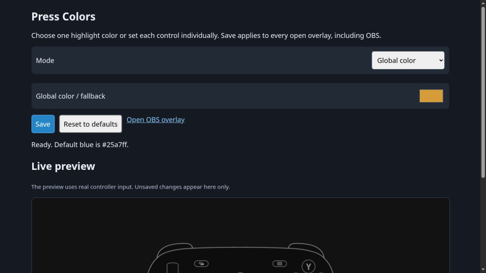

# Steam Controller Gamepad Viewer for Linux

A Linux/SteamOS port of **[Ramonchi_5’s Steam Controller Gamepad Viewer](https://github.com/ramonchi5/Steam-Controller-Gamepad-Viewer-by-Ramonchi_5)** for OBS, with direct access to the trackpads, rear controls, and sensors that generic gamepad overlays normally miss. Steam can remain running.

**[Download v2.0.2](../../releases/tag/v2.0.2)** · [All releases](../../releases) · [Changelog](CHANGELOG.md)



## Features

- Linux x86_64, including SteamOS / Steam Deck Desktop Mode.
- OBS Browser Source using the existing upstream controller artwork and visual customization.
- Passive, read-only physical HID input alongside Steam; no exclusive device grab, remapping, firmware commands, or root viewer.
- Live left/right trackpad positions, touch, and pressure; rear buttons L4/L5/R4/R5; grip-sense strips on supported hardware.
- Analog trigger depth, joystick movement/click/capacitive touch, and D-pad visualization.
- **Persistent global or per-control press colors**, with the original blue as the default.
- Local/offline operation after download, with the server bound only to `127.0.0.1:31337`.
- Live diagnostics, stale-input clearing, and periodic device rediscovery. Physical reconnect remains unverified.

## Press Colors

Open **http://127.0.0.1:31337/settings.html** and select:

- **Global color** — one highlight color for every control.
- **Per-control colors** — individual colors for buttons, triggers, sticks, pads, and grip regions.

Use the color pickers and **Save**; open overlays, including OBS, update automatically. Reset restores the original blue (`#25a7ff`). No JSON editing is required. Settings survive application, Steam, OBS, and system restarts in `~/.config/SteamControllerGamepadViewer/press-colors.json` (or the corresponding `$XDG_CONFIG_HOME` directory).



## Download

Go to **[GitHub Releases — v2.0.2](../../releases/tag/v2.0.2)** and download:

- `Steam.Controller.Gamepad.Viewer-Linux-x64-v2.0.2.tar.gz`
- `SHA256SUMS`

The archive includes the .NET runtime; an SDK is needed only to build from source. Standard Linux runtime dependencies, including glibc, OpenSSL, ICU, and zlib, must be available. They are already present on the tested SteamOS installation.

## Quick Start

1. Download both release assets and verify with `sha256sum -c SHA256SUMS`.
2. Extract with `tar -xzf Steam.Controller.Gamepad.Viewer-Linux-x64-v2.0.2.tar.gz`.
3. Enter `SteamControllerViewer-linux-x64` and run `./launch.sh` (or `./SteamControllerGamepadViewer`).
4. Install the included udev rule **only if device access is denied**; see HID Permissions.
5. Add the OBS Browser Source below.

Optional: `python3 install-desktop.py` installs an application-menu entry and an optional user service for this extracted folder. Keep that folder in a stable location. Autostart is not enabled automatically.

## OBS Setup

| Setting | Value |
|---|---|
| Source | Browser Source |
| URL | `http://127.0.0.1:31337/` |
| Width | `1200` |
| Height | `900` |
| Custom CSS | Empty |

Existing upstream URL style parameters remain supported. The overlay contains no permanent settings controls.

## Diagnostics

Open **http://127.0.0.1:31337/diagnostics.html** for live controls, observed ranges, and physical HID transport status.

Run `./launch.sh --debug` for discovery and report-count logging. If a user service is running, stop it first with `systemctl --user stop steam-controller-viewer.service` so only one server uses port 31337. Do not run the viewer as root.

## Supported Inputs

Hardware verification used a real controller through the **Valve Steam Controller Puck receiver (`28de:1304`)**, while Steam remained running. The Deck’s internal `28de:1205` device is deliberately excluded from the external-controller reader. Features vary by controller generation; a classic 2015 controller has two rear levers, not four.

| Input / capability | Status |
|---|---|
| A/B/X/Y, LB/RB | Hardware verified, including release transitions |
| Both analog triggers | Hardware verified through full range |
| Joystick X/Y, click, capacitive touch | Hardware verified |
| D-pad directions | Hardware verified |
| Left/right trackpad touch and live X/Y | Hardware verified |
| Left/right trackpad pressure | Hardware verified |
| L4/L5/R4/R5 | Hardware verified on the attached controller |
| Left/right grip-sense strips | Hardware verified |
| View, Menu, Steam button | Implemented; transitions not conclusively hardware captured |
| Digital trackpad-click flags | Implemented; flags not conclusively hardware captured; pressure visualization works |
| Quick Access | Implemented; not hardware verified |
| Automatic rediscovery and stale-state clearing | Implemented; physical sleep/unplug/reconnect not fully hardware verified |
| Classic-controller USB/dongle report decoding | Implemented and parser tested; classic hardware not verified |
| Bluetooth LE framing | Not implemented |
| Gyro visualization | Not provided |

## Steam Deck / SteamOS

Developed and tested on Steam Deck OLED running SteamOS Desktop Mode. **Steam can remain running** while the viewer reads physical input. The application is a Linux x86_64 build, not restricted to SteamOS, but other distributions and controller generations need their own hardware verification.

## HID Permissions

SteamOS already granted session access on the tested machine. If `/api/hid` reports access denied, run the included `./install-udev.sh`. It requests sudo only to install a narrowly scoped `uaccess` rule for the observed Valve receiver **28de:1304**, reload udev, and trigger a permission refresh. Reconnect the receiver if needed.

The rule intentionally does not grant access to every HID device. Other controller IDs need an appropriately reviewed rule. Never use `chmod 777` on HID devices or run the viewer as root.

## Building From Source

Install a **.NET 8 SDK** (see `global.json`), then run from the repository root:

```sh
dotnet restore SteamControllerGamepadViewer.sln
dotnet build SteamControllerGamepadViewer.sln -c Release --no-restore
dotnet test SteamControllerGamepadViewer.sln -c Release --no-build
dotnet publish src/SteamControllerGamepadViewer/SteamControllerGamepadViewer.csproj \
  -c Release -r linux-x64 --self-contained true -o artifacts/publish-linux-x64
./scripts/package-linux.sh 2.0.2 artifacts/publish-linux-x64
```

Archives and checksums appear in `artifacts/release/`. Run `./scripts/package-linux.sh 2.0.2` to perform publish and packaging together. `DOTNET` can point to a user-local SDK executable. No immutable SteamOS system changes are needed.

## How It Works

```text
Physical Steam Controller
  → passive Linux hidraw transport + existing upstream report parser
  → application state model
  → localhost ASP.NET Core server (127.0.0.1:31337)
  → browser overlay (server-sent events)
  → OBS Browser Source
```

Generic Gamepad API overlays often receive only a translated conventional gamepad, losing physical trackpad and rear-control data. The Linux backend reads vendor HID reports directly. It deliberately does not initialize SDL hardware drivers, avoiding configuration writes. The existing cross-platform SDL loader and Windows implementation are retained in source; SDL is not bundled or required by this Linux runtime.

## Known Limitations

- BLE framing is not implemented.
- View/Menu/Steam transitions and digital trackpad-click flags were not conclusively hardware captured.
- Classic-controller hardware and physical sleep/unplug/reconnect are not fully hardware verified.
- One active external controller is displayed at a time. Sensor availability depends on hardware generation.

## Credits

**Ramonchi_5 — original [Steam Controller Gamepad Viewer](https://github.com/ramonchi5/Steam-Controller-Gamepad-Viewer-by-Ramonchi_5).** This repository provides the Linux/SteamOS port and persistent press-color configuration; it does not claim authorship of the original project. Upstream history and copyright notices are preserved; the browser-source baseline is recorded in [LINUX_BASELINE.txt](LINUX_BASELINE.txt).

Built on Microsoft .NET / ASP.NET Core. The source retains SDL integration; Linux transport uses the system’s hidraw/libc interfaces. See [THIRD_PARTY_NOTICES.md](THIRD_PARTY_NOTICES.md) for dependencies, references, and Valve-owned artwork.

## Development

The Linux port was developed with **OpenAI Codex under human direction and physical hardware testing**. Automated parser/rendering tests and human controller testing have different scopes; the support table records the remaining verification gaps. Contributions are welcome: [CONTRIBUTING.md](CONTRIBUTING.md).

## License

Project code is MIT licensed; the original Ramonchi_5 copyright notice is retained in [LICENSE](LICENSE). Third-party components and Valve artwork retain their own rights and notices.

## Valve Disclaimer

Steam, Steam Controller, Steam Deck, Valve, and related names, marks, and artwork are trademarks/property of Valve Corporation. This project is unofficial and is not affiliated with, endorsed, or sponsored by Valve.
