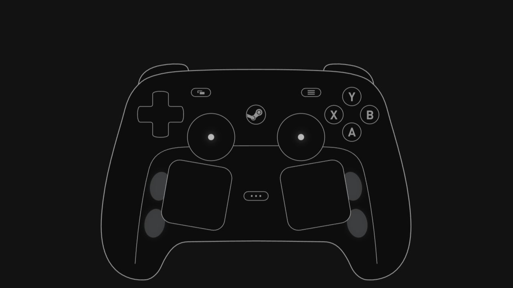

# Steam Controller Gamepad Viewer for Linux

A Linux/SteamOS OBS overlay derived from [Ramonchi_5’s original viewer](https://github.com/ramonchi5/Steam-Controller-Gamepad-Viewer-by-Ramonchi_5). Steam can remain running.

## [Download v2.0.2]({{ site.github.repository_url }}/releases/tag/v2.0.2)

Live physical trackpads, pressure/touch, four rear controls, grip sensing, analog
triggers, joystick touch, and persistent **global/per-control press colors**.
See the [repository support table]({{ site.github.repository_url }}#supported-inputs)
for hardware verification and limitations; BLE framing is not implemented.

OBS: `http://127.0.0.1:31337/` · **1200 × 900** · Custom CSS empty.
Settings: `http://127.0.0.1:31337/settings.html` — original blue by default.

[Source, setup and documentation]({{ site.github.repository_url }}) · [Releases]({{ site.github.repository_url }}/releases)

MIT project code with upstream attribution retained. Valve artwork and marks remain
Valve property. Unofficial project; no Valve endorsement or sponsorship.
